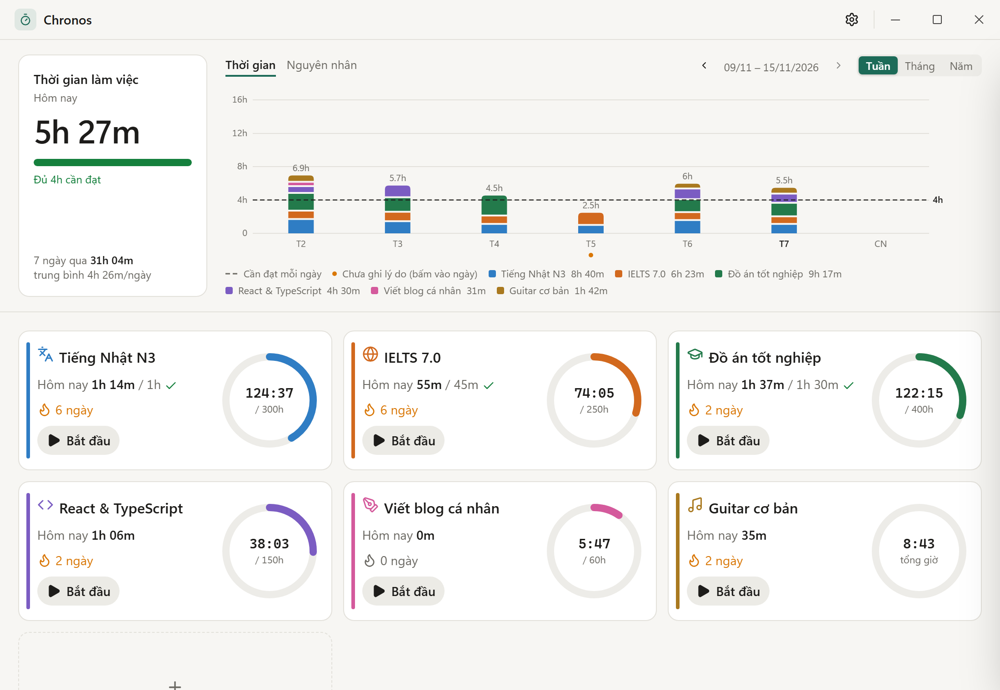
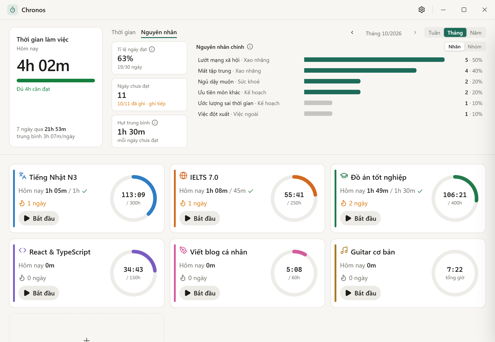
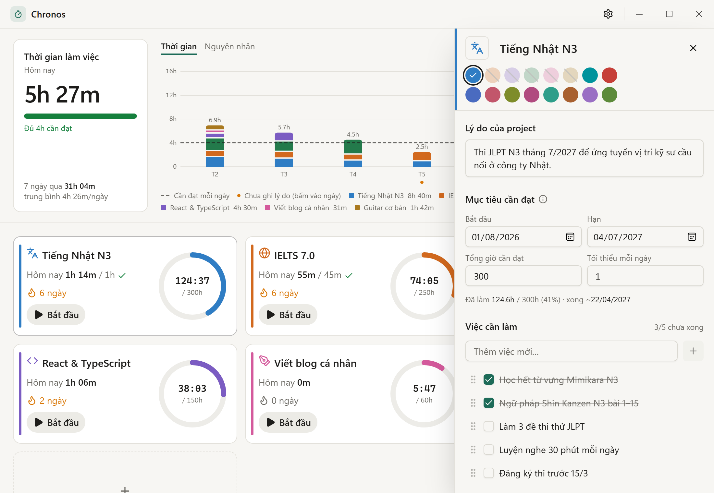

<div align="center">

# ⏱️ Chronos

**Ứng dụng desktop theo dõi thời gian, lấy stopwatch làm trung tâm.**
Ghi lại từng phút bạn dành cho các project dài hạn và dự báo ngày bạn sẽ hoàn thành.




</div>

---

## Ý tưởng

Học một ngôn ngữ mới, ôn thi chứng chỉ, làm đồ án hay một side project đều cần hàng trăm giờ. Khó nhất không phải là bắt đầu, mà là giữ nhịp mỗi ngày và nhìn ra điều gì đang kéo mình chậm lại.

Chronos giải quyết việc đó theo cách đơn giản nhất: mỗi project có một nút **Bắt đầu**. Bấm khi bắt đầu làm, bấm lại khi dừng. Từ thời gian đó, app cho bạn biết:

- Mỗi project đã làm được bao nhiêu giờ so với mục tiêu, và với tốc độ hiện tại thì **khi nào xong**.
- Hôm nay đã đủ thời gian cần làm chưa, và đang giữ được **chuỗi ngày** liên tục bao lâu.
- Những ngày chưa đạt là **vì sao**, và lý do nào lặp lại nhiều nhất để bạn xử lý trước.

Mọi dữ liệu nằm trên máy bạn. Không cần tài khoản, không có cloud.

## Tính năng

**Bấm giờ**
- Mỗi project một timer, tại một thời điểm chỉ một timer chạy.
- Khi dừng, app hỏi nhanh *"vừa làm gì?"* để ghi chú cho lần làm đó.
- Phím tắt `Ctrl+Shift+Space` bật/dừng timer gần nhất từ bất kỳ đâu, kể cả khi cửa sổ đang ẩn.
- Rời máy quá 10 phút trong lúc timer chạy, app hỏi bạn có muốn bỏ khoảng thời gian đó không.

**Project**
- Tên, biểu tượng, màu, tổng số giờ cần đạt, ngày bắt đầu và hạn chót.
- Lý do của project, việc cần làm, ghi chú và tài liệu liên quan nằm chung trong một panel chi tiết.
- Ngày hoàn thành dự kiến dựa trên tốc độ làm việc 14 ngày gần nhất.
- Kéo thả để sắp xếp thẻ project. Lưu trữ project đã xong để trang chủ gọn gàng.

**Báo cáo**
- Tab **Thời gian**: biểu đồ thời gian làm mỗi ngày theo từng project, xem theo tuần, tháng hoặc năm, kèm vạch thời gian cần đạt mỗi ngày.
- Bấm vào phần cột của một project để ghi lại **hôm đó đã làm gì**.
- Tab **Nguyên nhân**: tỉ lệ ngày đạt so với kỳ trước, số ngày chưa đạt, mức hụt trung bình, và bảng xếp hạng nguyên nhân làm nổi bật những lý do chiếm phần lớn số ngày chưa đạt.



**Chạy nền**
- Đóng cửa sổ thì app thu xuống khay hệ thống, timer vẫn chạy. Rê chuột vào biểu tượng khay để xem timer đang chạy.
- Tuỳ chọn khởi động cùng Windows.
- Giao diện sáng, tối hoặc theo hệ thống.
- Sao lưu toàn bộ dữ liệu ra JSON, hoặc xuất bảng các lần làm việc ra CSV để mở bằng Excel.

## Cài đặt

Tải file `Chronos_x.y.z_x64-setup.exe` ở mục [Releases](https://github.com/HieuXiao/chronos/releases) rồi chạy để cài.

> File cài đặt chưa được ký số nên Windows có thể hiện cảnh báo *"Windows protected your PC"*. Chọn **More info → Run anyway** để tiếp tục.

## Cách dùng



1. **Đặt thời gian cần làm mỗi ngày.** Mở **Cài đặt** (biểu tượng bánh răng), nhập số giờ, ví dụ `6`. Con số này hiện thành vạch ngang trên biểu đồ.
2. **Tạo project.** Bấm **Thêm project**, đặt tên, chọn màu và nhập tổng số giờ cần đạt, ví dụ 200 giờ cho "Học tiếng Nhật N3". Có thể đặt thêm mức tối thiểu mỗi ngày cho riêng project đó.
3. **Bấm Bắt đầu** khi làm, **Dừng** khi xong, rồi ghi một dòng ngắn về việc vừa làm.
4. **Bấm vào thẻ project** để mở panel chi tiết: lý do làm project, mục tiêu, việc cần làm, ghi chú và tài liệu. Bấm ra ngoài để đóng.
5. **Cuối ngày, xem biểu đồ.** Ngày nào chưa đủ giờ sẽ có dấu chấm cam dưới cột. Bấm vào đó, chọn các nhãn lý do như *Lướt mạng xã hội*, *Ngủ dậy muộn*, *Việc đột xuất*… hoặc tạo nhãn mới.
6. **Mỗi tuần, mở tab Nguyên nhân** để xem tỉ lệ ngày đạt đang tăng hay giảm và lý do nào cần xử lý trước.

Sau khoảng 7 ngày có dữ liệu, panel chi tiết bắt đầu hiển thị ngày hoàn thành dự kiến của project.

### Phím tắt

| Phím | Chức năng |
|---|---|
| `Ctrl+Shift+Space` | Bật/dừng timer gần nhất (dùng được ở mọi nơi) |
| `Esc` | Đóng panel chi tiết |

## Build từ mã nguồn

Cần [Node.js](https://nodejs.org/) 20+, [Rust](https://rustup.rs/) và các [yêu cầu của Tauri](https://v2.tauri.app/start/prerequisites/).

```bash
npm install
```

```bash
npm run tauri dev
```

```bash
npm run tauri build
```

Lệnh `tauri dev` chạy app ở chế độ phát triển. Lệnh `tauri build` tạo file cài đặt trong `src-tauri/target/release/bundle/`.

## Giấy phép

[MIT](LICENSE) © 2026 Ngo Minh Hieu.
